# Software Requirements Specification (SRS)
## For
# Smart Bicycle Rental System (EcoRide)
### With Dynamic Dock Rebalancing & Carbon Offset Tracking

---

**Document Version**: 1.0.0 (Production Core)  
**Status**: Approved & Baseline Verified  
**Standard**: IEEE Std 830-1998 Recommended Practice  
**Architecture**: 3-Tier Desktop Client (Java 17 FlatLaf) / MySQL Relational Engine  
**Release Date**: September 2026  

---

## Table of Contents
- [1. Introduction](#1-introduction)
  - [1.1 Purpose](#11-purpose)
  - [1.2 Document Conventions](#12-document-conventions)
  - [1.3 Intended Audience and Reading Suggestions](#13-intended-audience-and-reading-suggestions)
  - [1.4 Product Scope](#14-product-scope)
  - [1.5 References](#15-references)
- [2. Overall Description](#2-overall-description)
  - [2.1 Product Perspective](#21-product-perspective)
  - [2.2 Product Functions](#22-product-functions)
  - [2.3 User Classes and Characteristics](#23-user-classes-and-characteristics)
  - [2.4 Operating Environment](#24-operating-environment)
  - [2.5 Design and Implementation Constraints](#25-design-and-implementation-constraints)
  - [2.6 User Documentation](#26-user-documentation)
  - [2.7 Assumptions and Dependencies](#27-assumptions-and-dependencies)
- [3. External Interface Requirements](#3-external-interface-requirements)
  - [3.1 User Interfaces (Java Swing GUI)](#31-user-interfaces-java-swing-gui)
  - [3.2 Hardware Interfaces](#32-hardware-interfaces)
  - [3.3 Software Interfaces](#33-software-interfaces)
  - [3.4 Communications Interfaces](#34-communications-interfaces)
- [4. System Features](#4-system-features)
  - [4.1 Feature 1: User Registration, Authentication & Wallet](#41-feature-1-user-registration-authentication--wallet)
  - [4.2 Feature 2: Multi-Station Fleet Catalog & Availability](#42-feature-2-multi-station-fleet-catalog--availability)
  - [4.3 Feature 3: Smart Reservation & OTP Digital Unlock](#43-feature-3-smart-reservation--otp-digital-unlock)
  - [4.4 Feature 4: Live Trip Metering & Active Concurrency](#44-feature-4-live-trip-metering--active-concurrency)
  - [4.5 Feature 5: Dynamic Dock Rebalancing & Capacity Alerts](#45-feature-5-dynamic-dock-rebalancing--capacity-alerts)
  - [4.6 Feature 6: Eco-Credit Rewards & CO₂ Offset Tracker](#46-feature-6-eco-credit-rewards--co2-offset-tracker)
  - [4.7 Feature 7: Docking Return, Automated Billing & Invoice](#47-feature-7-docking-return-automated-billing--invoice)
  - [4.8 Feature 8: Maintenance & Fault Reporting System](#48-feature-8-maintenance--fault-reporting-system)
  - [4.9 Feature 9: Administrative Fleet Control & Analytics](#49-feature-9-administrative-fleet-control--analytics)
- [5. Other Nonfunctional Requirements](#5-other-nonfunctional-requirements)
  - [5.1 Performance Requirements](#51-performance-requirements)
  - [5.2 Safety Requirements](#52-safety-requirements)
  - [5.3 Security Requirements](#53-security-requirements)
  - [5.4 Software Quality Attributes](#54-software-quality-attributes)
  - [5.5 Business Rules](#55-business-rules)
- [Appendix A: Glossary](#appendix-a-glossary)
- [Appendix B: Analysis Models (Flowchart, DFD, Use Case, ERD)](#appendix-b-analysis-models)
- [Appendix C: To Be Determined (TBD) List](#appendix-c-to-be-determined-tbd-list)

---

## 1. Introduction

### 1.1 Purpose
This Software Requirements Specification (SRS) document details the complete functional and non-functional specifications for the **Smart Bicycle Rental System (EcoRide)** desktop client application. It serves as the formal architectural specification between system developers, engineering leads, and platform administrators, aligning strictly with IEEE Std 830-1998 guidelines.

### 1.2 Document Conventions
- **Typography Standards**: Body text formatted in 12 pt Times New Roman; primary headings formatted in 14 pt bold; subheadings in 12 pt bold.
- **Requirement Identifiers**: Every functional requirement is tagged with a unique alphanumeric identifier in the format `REQ-X.Y` (e.g., `REQ-1.1`).
- **Priority Ratings**: Each feature is categorized into High (Core Baseline), Medium (Operational Feature), or Low (Planned Extension).

### 1.3 Intended Audience and Reading Suggestions
- **System Architects & Technical Leads**: Focus on Section 2.2 (Product Functions), Section 3 (Interfaces), Section 4 (Functional Features), and Appendix B (Analysis Models).
- **Developers & System Programmers**: Focus on Section 4 (System Features), Section 5 (Non-Functional Requirements), and the database schema mapping.
- **System Testers**: Reference Section 4 and Section 5 for test cases, boundary conditions, and acceptance criteria.

### 1.4 Product Scope
The **EcoRide Smart Bicycle Rental System** is a client-server desktop application developed in Java Swing and backed by MySQL. It manages the complete lifecycle of a public or university campus bike-sharing network:
- Customer account creation, wallet management, and identity verification.
- Real-time station capacity and bicycle status queries across multiple geographic docks.
- OTP-based digital smart-unlock simulation.
- Real-time trip timing, dynamic cost computation, and automatic dock-return billing.
- Novel ecological features: calculation of carbon emissions prevented ($0.21\text{ kg CO}_2/\text{km}$) and calories burned ($7.5\text{ kcal/min}$), converting these into redeemable "Eco-Credits".
- Fleet rebalancing intelligence alerting operators to station imbalances.
- Complete CRUD management for administrators and technicians.

### 1.5 References
1. IEEE Std 830-1998: *IEEE Recommended Practice for Software Requirements Specifications*.
2. Java™ Platform, Standard Edition 17 API Specification (Oracle Corporation).
3. MySQL 8.0 Reference Manual (Oracle Corporation).
4. Smart Mobility & Shared Micromobility Operational Guidelines (2026).

---

## 2. Overall Description

### 2.1 Product Perspective
EcoRide is an independent, self-contained desktop information system. It adopts a modular 3-tier architecture:
1. **Tier 1 (Presentation)**: Java Swing graphical user interface running on the local client machine.
2. **Tier 2 (Application / Business Logic)**: Core Java services handling validation, fare metering, carbon offset calculations, and thread coordination.
3. **Tier 3 (Data Storage)**: MySQL relational database management system accessed via JDBC using thread-safe connection pooling.

```
[Java Swing GUI Screens]  <--->  [Business Services & DAOs]  <--->  [JDBC API]  <--->  [MySQL 8.0 DB]
```

### 2.2 Product Functions
- **User Authentication**: Login/Registration with role segregation (Customer, Operator, Admin).
- **Dock & Bike Discovery**: Station filtering, bike type selection (Standard, Geared, Electric), battery level inspection.
- **Reservation & Smart Unlock**: 6-digit cryptographic PIN token generation to initiate a ride.
- **Ride Monitoring**: Live running duration clock, real-time fare accumulator, emergency assistance.
- **Dynamic Rebalancing (USP #1)**: Proactive station saturation alerts and nearby return dock recommendations.
- **Eco-Credit Engine (USP #2)**: Tangible carbon offset and fitness tracking with in-app wallet discounts.
- **Automated Check-in & Invoicing**: Automatic wallet deduction, transaction receipt generation, and station inventory sync.
- **Maintenance Lifecycle**: Fault flagging by riders/staff and technician repair management.

### 2.3 User Classes and Characteristics
1. **Customer / Rider**: Students, faculty, or campus visitors with basic computer skills. Expects a straightforward, visually appealing GUI, fast booking, transparent pricing, and instant receipts.
2. **Station Operator / Technician**: Field staff responsible for bike rebalancing, battery charging, and repair. Requires access to dock saturation levels and maintenance log entries.
3. **System Administrator**: IT/Operations managers responsible for adding stations, creating bicycles, setting base/hourly fares, and auditing financial reports.

### 2.4 Operating Environment
- **Client Hardware**: Any modern x86_64 computer with $\ge 4\text{ GB RAM}$ and $500\text{ MB}$ free disk space.
- **Client Software**: Windows 10/11, Linux, or macOS with OpenJDK 17 or higher.
- **Database Engine**: MySQL Server 8.0 or higher running locally on port 3306.
- **Display Resolution**: Optimized for $1280 \times 720$ and $1920 \times 1080$.

### 2.5 Design and Implementation Constraints
- **Swing Framework**: Built strictly using pure Java standard library Swing/AWT components for cross-platform portability without heavy third-party GUI frameworks.
- **Thread Safety**: UI rendering is strictly confined to the Event Dispatch Thread (EDT). Long-running background operations utilize dedicated threads or `javax.swing.Timer`.
- **Database Security**: All SQL interactions must employ `java.sql.PreparedStatement` to prevent SQL Injection vulnerabilities.
- **Offline/Local Capability**: The system must run autonomously on a standalone local machine without requiring cloud internet connectivity.

### 2.6 User Documentation
- Comprehensive user manual embedded in the application under `Help -> User Manual`.
- Database initialization and configuration instructions provided in `db/schema.sql` and `README.md`.

### 2.7 Assumptions and Dependencies
- The target machine has MySQL Server running with database `bicycle_rental_db` created and credentials configured.
- MySQL Connector/J JDBC driver library (`mysql-connector-j-8.x.jar`) is placed on the Java classpath.

---

## 3. External Interface Requirements

### 3.1 User Interfaces (Java Swing GUI)
The application user interface adheres to modern ergonomics, utilizing high-contrast color palettes, rounded borders, card layouts, and responsive font scaling:
- **UI-1 (Login & Sign-Up)**: Dual tabbed/dialog interface for credential verification and new account registration with instant form validation cues.
- **UI-2 (Customer Dashboard)**: Header displaying active user profile, wallet balance, and accumulated Eco-Credits; center panel containing metrics cards (*Active Rides*, *Total KM*, *CO₂ Saved*); navigation toolbar.
- **UI-3 (Bike Catalog & Reservation)**: Split pane interface with station list on the left and available bicycle cards/table on the right with battery % meters.
- **UI-4 (Active Ride HUD)**: Dedicated dialog featuring a running stopwatch (`00:15:32`), live estimated fare ($₹ 15.00$), and "End Ride & Dock" action button.
- **UI-5 (Receipt & Billing Dialog)**: Formatted modal invoice display with print/save options.
- **UI-6 (Admin / Fleet Console)**: Tabbed table views for bicycle CRUD, station capacity configuration, maintenance ticket resolution, and revenue charts.

### 3.2 Hardware Interfaces
- Standard Keyboard and Mouse for user input.
- Monitor resolution $\ge 1280 \times 720$.
- Optional local printer for physical invoice printing.

### 3.3 Software Interfaces
- **Java Virtual Machine**: OpenJDK 17.0+.
- **JDBC Driver**: MySQL Connector/J 8.0+.
- **DBMS**: MySQL Community Server 8.0+.

### 3.4 Communications Interfaces
- TCP/IP socket connection over port 3306 for JDBC client-to-database communication.

---

## 4. System Features

### 4.1 Feature 1: User Registration, Authentication & Wallet
- **Description**: Allows new users to create an account, log in securely, and manage their pre-paid wallet balance.
- **Priority**: High (Core Baseline)
- **Functional Requirements**:
  - `REQ-1.1`: System shall validate that username and email are unique across all accounts.
  - `REQ-1.2`: Password must be securely hashed using SHA-256 before storage; no plaintext passwords permitted.
  - `REQ-1.3`: System shall initialize new customer accounts with a default introductory wallet balance (e.g., INR 200.00).
  - `REQ-1.4`: Users shall have the ability to top up their wallet balance using simulated payment methods (UPI, Card, Cash).

### 4.2 Feature 2: Multi-Station Fleet Catalog & Availability
- **Description**: Displays all registered docking stations and lists available bicycles filtered by type.
- **Priority**: High (Core Baseline)
- **Functional Requirements**:
  - `REQ-2.1`: System shall retrieve and display all active stations with total docks and current available bike count.
  - `REQ-2.2`: System shall allow filtering bicycles by category: Standard, Geared, and Electric.
  - `REQ-2.3`: For Electric bicycles, the current battery percentage must be visibly indicated with a color-coded status bar.

### 4.3 Feature 3: Smart Reservation & OTP Digital Unlock
- **Description**: Coordinates the bicycle checkout process and generates a secure one-time unlock code.
- **Priority**: High (Core Baseline)
- **Functional Requirements**:
  - `REQ-3.1`: System shall verify that the user has a minimum wallet balance of at least INR 50.00 before reservation.
  - `REQ-3.2`: System shall verify that the user does not have an existing unfinished active rental.
  - `REQ-3.3`: Upon booking confirmation, the system shall generate a random 6-digit numeric unlock PIN.
  - `REQ-3.4`: System shall atomically transition the bicycle status to `IN_USE` and decrement the station's available bike count.

### 4.4 Feature 4: Live Trip Metering & Active Concurrency
- **Description**: Tracks the ride in real time on an independent thread, metering duration and calculating accrued costs.
- **Priority**: High (Core Baseline)
- **Functional Requirements**:
  - `REQ-4.1`: System shall run a background timer updating the elapsed time every second without freezing the Swing GUI.
  - `REQ-4.2`: Base fare (e.g., INR 10.00) applies to the first 15 minutes; subsequent minutes are metered at a fixed per-minute rate according to the bike type.
  - `REQ-4.3`: If the application is unexpectedly closed, the active rental status remains persisted in the database with original start timestamp.

### 4.5 Feature 5: Dynamic Dock Rebalancing & Capacity Alerts
- **Description**: Proactively monitors station capacity to prevent dock saturation and guides riders to nearby stations.
- **Priority**: High (Core Baseline)
- **Functional Requirements**:
  - `REQ-5.1`: When a station's available docks drop below 15%, the system flags it as `STARVED` and notifies operators.
  - `REQ-5.2`: When a station reaches $\ge 90\%$ capacity, the system flags it as `CONGESTED`.
  - `REQ-5.3`: If a rider attempts to return a bicycle to a station with zero empty docks, the system blocks the docking and automatically displays the nearest alternative station with walking distance.

### 4.6 Feature 6: Eco-Credit Rewards & CO₂ Offset Tracker
- **Description**: Computes environmental and health impact metrics, awarding redeemable loyalty credits.
- **Priority**: High (Core Baseline)
- **Functional Requirements**:
  - `REQ-6.1`: System shall estimate trip distance: $\text{Distance (km)} = \text{Duration (hours)} \times 14\text{ km/h (average speed)}$.
  - `REQ-6.2`: System shall compute CO₂ emissions avoided: $\text{CO}_2\text{ Saved (kg)} = \text{Distance (km)} \times 0.21\text{ kg/km}$.
  - `REQ-6.3`: System shall compute calories burned: $\text{Calories (kcal)} = \text{Duration (min)} \times 7.5\text{ kcal/min}$.
  - `REQ-6.4`: For every $0.5\text{ kg}$ of CO₂ saved, the user is awarded 1 Eco-Credit ($1\text{ Credit} = \text{INR } 1.00\text{ discount}$).

### 4.7 Feature 7: Docking Return, Automated Billing & Invoice
- **Description**: Concludes the rental session, updates inventory, debits wallet balance, and issues an itemized receipt.
- **Priority**: High (Core Baseline)
- **Functional Requirements**:
  - `REQ-7.1`: User selects destination station; system confirms empty dock availability.
  - `REQ-7.2`: Total fare is calculated; Eco-Credits are applied if requested by the user.
  - `REQ-7.3`: Net amount is automatically deducted from the user's wallet balance within a single transactional boundary.
  - `REQ-7.4`: System generates an itemized invoice dialog displaying Rental ID, Duration, Fare, Eco-Discount, and Final Balance.

### 4.8 Feature 8: Maintenance & Fault Reporting System
- **Description**: Enables riders or staff to report mechanical issues, automatically locking the bike from further checkout.
- **Priority**: Medium (Operational Feature)
- **Functional Requirements**:
  - `REQ-8.1`: Rider can report issues (Flat Tire, Brakes, Chain, Battery) during return.
  - `REQ-8.2`: Reported bikes are immediately assigned status `MAINTENANCE`.
  - `REQ-8.3`: Technicians can view open maintenance tickets, enter repair costs, and transition status back to `AVAILABLE`.

### 4.9 Feature 9: Administrative Fleet Control & Analytics
- **Description**: Full administrative dashboard for fleet management, station oversight, and revenue monitoring.
- **Priority**: Medium (Operational Feature)
- **Functional Requirements**:
  - `REQ-9.1`: Admins can perform full CRUD operations on Bicycles and Stations.
  - `REQ-9.2`: System provides summary metrics: Total Fleet Count, Active Rentals, Total Revenue Generated, and Total Campus CO₂ Offset.

---

## 5. Other Nonfunctional Requirements

### 5.1 Performance Requirements
- Query execution and table reloading must complete within $<150\text{ ms}$.
- Memory footprint of the client application must remain under $150\text{ MB RAM}$.

### 5.2 Safety Requirements
- In the event of system crash or sudden power termination, active rental states must remain intact in MySQL to prevent data corruption or lost rental records.

### 5.3 Security Requirements
- Passwords must be hashed using SHA-256 with salt.
- Role-based authorization: Customers cannot access administrative CRUD panels.
- Parameterized SQL queries must be enforced across all database queries.

### 5.4 Software Quality Attributes
- **Maintainability**: Clear separation of concerns following the MVC and DAO design patterns.
- **Portability**: Code runs without modification on Windows, macOS, and Linux systems with standard Java 17 runtime.
- **Robustness**: Comprehensive try-catch-finally blocks with meaningful error dialogs presented to the user instead of raw terminal stack traces.

### 5.5 Business Rules
- Minimum age requirement: 16 years.
- Maximum rental duration per single session: 24 hours (beyond which penalty rates apply).
- Minimum wallet balance to initiate a ride: ₹50.00.

---

## Appendix A: Glossary

- **Dock**: A physical or virtual parking slot at a station where a bicycle is secured.
- **Dock Saturation**: The percentage of occupied docks at a given station.
- **Eco-Credit**: A virtual loyalty point awarded to riders based on greenhouse gas emissions saved.
- **DAO (Data Access Object)**: A design pattern that provides an abstract interface to a database.
- **EDT (Event Dispatch Thread)**: The background thread in Java Swing responsible for dispatching GUI events.

---

## Appendix B: Analysis Models

### B.1 High-Level Use Case Model
```
                  ┌─────────────────────────────────────────────────────────┐
                  │               SMART BICYCLE RENTAL SYSTEM               │
                  │                                                         │
                  │   [ Register & Login ]                                  │
                  │          ▲                                              │
                  │          │                                              │
( Customer ) ─────┼──>[ Browse Stations & Bikes ]                           │
                  │   [ Unlock Bike with OTP ]                              │
                  │   [ View Active Trip Timer ]                            │
                  │   [ Return Bike & Pay Fare ]                            │
                  │   [ Earn Eco-Credits & Track CO2 ]  <-- (USP)           │
                  │   [ Report Maintenance Issue ]                          │
                  │                                                         │
                  │   [ Monitor Dock Saturation ]       <-- (USP)           │
( Operator ) ─────┼──>[ Rebalance Station Fleet ]                           │
                  │   [ Service & Repair Bicycles ]                         │
                  │                                                         │
                  │   [ CRUD Bicycles & Stations ]                          │
( Admin ) ────────┼──>[ Configure Rates & Docks ]                           │
                  │   [ View Revenue & Campus Green Reports ]               │
                  │                                                         │
                  └─────────────────────────────────────────────────────────┘
```

### B.2 System Flowchart (Rental Lifecycle)
```
       [ Start: User Login ]
                 │
                 ▼
     [ Check Wallet Balance >= ₹50 ] ──(No)──> [ Prompt Wallet Top-up ]
                 │ (Yes)
                 ▼
    [ Select Station & Bicycle ]
                 │
                 ▼
     [ Generate 6-Digit Unlock PIN ]
                 │
                 ▼
  [ Update DB: Bike=IN_USE, Station Count - 1 ]
                 │
                 ▼
   [ Start Active Trip Timer (EDT Safe) ]
                 │
                 ▼
         [ Rider Reaches Destination ]
                 │
                 ▼
    [ Check Destination Dock Capacity ]
          │                    │
        (Full)             (Available)
          │                    │
          ▼                    ▼
   [ Suggest Nearest   [ Confirm Dock Return ]
   Alternative Station ]       │
                               ▼
            [ Calculate Duration, Fare, CO2 Saved ]
                               │
                               ▼
            [ Apply Eco-Credits Discount if Selected ]
                               │
                               ▼
             [ Debit User Wallet & Commit DB Txn ]
                               │
                               ▼
                [ Display & Print Receipt ]
                               │
                               ▼
                             [ End ]
```

### B.3 Data Flow Diagrams (DFD)

#### B.3.1 Level 0 DFD (Context Diagram)
The Context-Level Data Flow Diagram establishes the system boundary for the **Smart Bicycle Rental System (EcoRide)**, modeling the entire platform as a single operational process (`0.0`) interacting with external entities (`Customer`, `Station Operator`, `System Administrator`, and `Payment Simulator`). In adherence with IEEE 830 DFD standards, internal database tables are encapsulated inside Process `0.0`.

```
+-----------------------------------------------------------------------------------------------+
|                                    LEVEL 0 DFD (CONTEXT DIAGRAM)                              |
+-----------------------------------------------------------------------------------------------+

                             +-----------------------------------+
                             |     E3: System Administrator      |
                             +-----------------------------------+
                               |  ^                         ^  |
      [10. Fleet/Station CRUD] |  | [J. Fleet Health]       |  | [11. Tariff Config]
      [9. Admin Credentials]   |  | [K. Revenue Analytics]  |  |
                               v  |                         |  v
+-----------------------------------------------------------------------------------------------+
|                                                                                               |
|                       +-----------------------------------------------+                       |
|                       |                                               |                       |
|  +----------------+   |                     0.0                       |   +----------------+  |
|  |                |==>|                                               |==>|                |  |
|  |  E1: Customer  |   |          Smart Bicycle Rental System          |   |  E2: Operator  |  |
|  |    (Rider)     |<==|                    (EcoRide)                  |<==|  (Technician)  |  |
|  |                |   |                                               |   |                |  |
|  +----------------+   |                                               |   +----------------+  |
|     |  ^              +-----------------------------------------------+             |  ^      |
|     |  |                                  ^       |                                 |  |      |
|     |  | [A. Auth & Profile]              |       | [L. Payment Debit Req]          |  |      |
|     |  | [B. Catalog & Battery %]         |       |                                 |  |      |
|     |  | [C. 6-Digit Unlock PIN]          |       v                                 |  |      |
|     |  | [D. Live HUD Metrics]        +-----------------------+                     |  |      |
|     |  | [E. Itemized Invoice]        | E4: Payment Gateway   |                     |  |      |
|     |  | [F. Eco-Credit/CO2 Summary]  |     (Simulator)       |                     |  |      |
|     |  | [G. Alt-Station Guidance]    +-----------------------+                     |  |      |
|     |  |                                  |                                         |  |      |
|     |  |                                  | [12. Txn Status & Auth]                 |  |      |
|     |  +----------------------------------+-----------------------------------------+  |      |
|     |                                                                                  |      |
|     +==[1. Reg/Login Credentials]======================================================+      |
|     +==[2. Wallet Top-up]==============================================================+      |
|     +==[3. Catalog Filter Query]===========> [H. Saturation Alerts (Starved/Congested)]+      |
|     +==[4. Bike Reservation Request]=======> [I. Maintenance Ticket Queue]             |      |
|     +==[5. Return Dock & Discount Preference]                                          |      |
|     +==[6. Fault Report] <================== [7. Rebalance Transfer Log]===============+      |
|                          <================== [8. Repair Cost & Status Resolution]======+      |
+-----------------------------------------------------------------------------------------------+
```

```mermaid
flowchart TD
    classDef entity fill:#1e293b,stroke:#0ea5e9,stroke-width:2px,color:#f8fafc;
    classDef process fill:#065f46,stroke:#10b981,stroke-width:3px,color:#ecfdf5,font-weight:bold;
    classDef gateway fill:#3b0764,stroke:#a855f7,stroke-width:2px,color:#faf5ff;

    E1["Customer (Rider)"]:::entity
    E2["Station Operator / Technician"]:::entity
    E3["System Administrator"]:::entity
    E4["Payment Gateway / Simulator"]:::gateway

    P0(("0.0<br/>Smart Bicycle Rental System<br/>(EcoRide Core)")):::process

    E1 -->|Reg, Credentials, Top-up| P0
    E1 -->|Bike Reservation & Return Dock| P0
    E1 -->|Fault / Damage Report| P0

    P0 -->|Auth Session & Profile| E1
    P0 -->|Bike Catalog, Docks & Battery %| E1
    P0 -->|6-Digit Crypto Unlock PIN| E1
    P0 -->|Live Ride HUD (Duration, Fare, KM)| E1
    P0 -->|Itemized Invoice & Eco-Credits| E1
    P0 -->|Congestion Alert & Alt-Station Guidance| E1

    P0 -->|Dock Saturation Alerts (Starved/Congested)| E2
    P0 -->|Open Maintenance Tickets| E2
    E2 -->|Rebalance Transfer Logs & Repair Status| P0

    E3 -->|Admin Credentials & Fleet/Station CRUD| P0
    E3 -->|Tariff & Hourly Rate Config| P0
    P0 -->|Fleet Distribution & Revenue/CO2 Reports| E3

    P0 -->|Payment Settlement Request| E4
    E4 -->|Payment Approval & Txn Ref ID| P0
```

#### B.3.2 Level 1 DFD (Decomposed System Overview)
Level 1 decomposes Process `0.0` into 9 primary functional modules and reveals the 6 persistent relational data stores (`D1: Users`, `D2: Stations`, `D3: Bicycles`, `D4: Rentals`, `D5: Payments`, `D6: Maintenance Logs`):

```mermaid
flowchart TD
    classDef entity fill:#0f172a,stroke:#38bdf8,stroke-width:2px,color:#f8fafc;
    classDef process fill:#1e3a8a,stroke:#60a5fa,stroke-width:2px,color:#eff6ff;
    classDef usp fill:#064e3b,stroke:#34d399,stroke-width:2px,color:#ecfdf5,font-weight:bold;
    classDef datastore fill:#312e81,stroke:#818cf8,stroke-width:2px,color:#e0e7ff;

    E1["Customer (Rider)"]:::entity
    E2["Station Operator"]:::entity
    E3["Administrator"]:::entity

    D1[("D1: Users")]:::datastore
    D2[("D2: Stations")]:::datastore
    D3[("D3: Bicycles")]:::datastore
    D4[("D4: Rentals")]:::datastore
    D5[("D5: Payments")]:::datastore
    D6[("D6: Maintenance Logs")]:::datastore

    P1("1.0 Authenticate & Wallet"):::process
    P2("2.0 Station & Fleet Catalog"):::process
    P3("3.0 Reservation & OTP Unlock"):::process
    P4("4.0 Live Trip Metering (HUD)"):::process
    P5("5.0 Dock Return & Rebalancing"):::usp
    P6("6.0 Fare Settlement & Invoice"):::process
    P7("7.0 Eco-Credits & CO2 Tracker"):::usp
    P8("8.0 Maintenance & Repairs"):::process
    P9("9.0 Admin Fleet & Analytics"):::process

    E1 -->|Credentials / Top-up| P1
    P1 -->|Auth Token & Balance| E1
    P1 <-->|Read/Write User| D1

    E1 -->|Station & Type Filter| P2
    P2 -->|Station & Bike List| E1
    D2 -.->|Read Capacities| P2
    D3 -.->|Read Bikes| P2

    E1 -->|Book Bike| P3
    P3 -->|6-Digit PIN| E1
    P3 -.->|Verify Balance >= 50| D1
    P3 -->|Bike Status=IN_USE| D3
    P3 -->|Decrement Docks| D2
    P3 -->|Create Rental Record| D4

    P3 -->|Start Metering| P4
    P4 -->|Live HUD Stream| E1
    P4 <-->|Meter Running Fare| D4

    E1 -->|Dock at End Station| P5
    P5 <-->|Verify Dock Saturation| D2
    P5 -->|Starved/Congested Alerts| E2
    P5 -->|Alternative Station Suggestion| E1

    P5 -->|Clear Return| P6
    E1 -->|Redeem Credits| P6
    P6 <-->|Rental Status=COMPLETED| D4
    P6 -->|Deduct Net Fare| D1
    P6 -->|Insert Payment Record| D5
    P6 -->|Bike Status=AVAILABLE| D3
    P6 -->|Increment Dock Count| D2
    P6 -->|Digital Invoice| E1

    P6 -->|Trip Duration & KM| P7
    P7 -->|Credit Eco-Points| D1
    P7 -->|Save CO2 Offset| D4
    P7 -->|Green Impact Card| E1

    E1 -->|Report Fault| P8
    E2 -->|Repair Log| P8
    P8 -->|Open Tickets| E2
    P8 -->|Bike Status=MAINTENANCE| D3
    P8 <-->|Read/Write Tickets| D6

    E3 -->|CRUD Stations/Bikes| P9
    P9 <-->|Sync Fleet Config| D2
    P9 <-->|Sync Fleet Config| D3
    P9 <-->|Aggregate Financials| D4
    P9 <-->|Aggregate Financials| D5
    P9 -->|Fleet KPI & Green Reports| E3
```



---

## Appendix C: To Be Determined (TBD) List

- *TBD-1*: Physical IoT hardware lock integration via MQTT protocol (planned for future post-graduate extension).
- *TBD-2*: Integration with third-party payment gateway APIs (e.g., Razorpay/Stripe webhooks).
